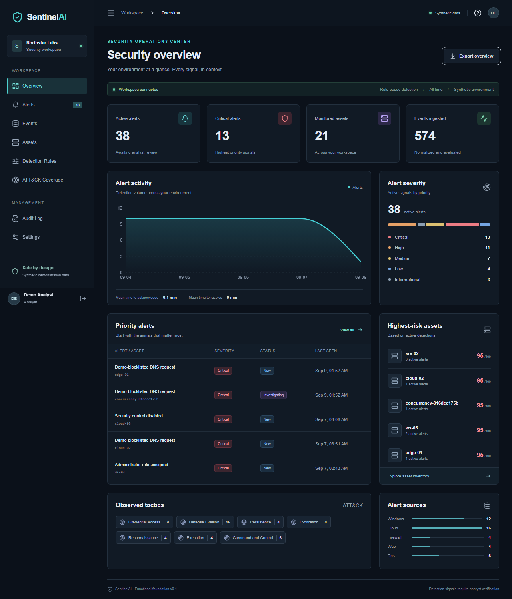
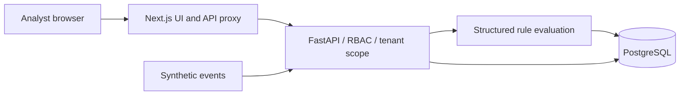

# SentinelAI

**Open-source intelligent SOC for small security teams.**

   

> **Release status: Phase 1 foundation.** Functional defensive monitoring, tenant-isolated workspaces, reproducible detections and evidence-led alert investigation. Incident management, AI providers, phishing analysis and anomaly detection are **not implemented yet**. This is a portfolio application, not a production-certified SOC.

<!-- Banner placeholder: replace with a project banner when publishing. CI badge placeholder: insert the actual repository Actions URL after creating the repository. -->

## What this project demonstrates

- **Full-stack engineering:** Next.js App Router, typed forms, TanStack Query, FastAPI, SQLAlchemy and Alembic.
- **Cybersecurity monitoring:** normalized events, an asset inventory, severity-based triage and evidence timelines.
- **Secure application design:** Argon2 passwords, rotating sessions, live role checks, tenant scoping and bounded requests.
- **Detection engineering:** structured conditions, event-time windows, thresholds and explicit evidence, with behavioral tests.
- **DevOps and testing:** Compose, health checks, migrations, unit/integration tests, browser workflows and CI configuration.
- **Technical documentation:** architecture diagrams, API examples, a threat model and reproducible demo instructions.
- **Planned demonstrations:** AI safety boundaries and explainable machine-learning signals belong to Phase 3; no AI/ML results are claimed in this release.

## The problem

Small teams need to move from scattered security logs to clear, reviewable decisions. SentinelAI makes that path visible: ingest a harmless event, see exactly which rule matched, inspect its evidence, assign an analyst and record a decision. The sample data is fictional and uses documentation address ranges and `.example` domains.

## Screenshots



The screenshot is generated by the Playwright dashboard test against the actual seeded API. See `docs/verification.md` for executed checks and environment limitations.

## Implemented capabilities

| Area | Available in v0.1 |
|---|---|
| Identity | Registration creates a new organization; login, refresh rotation, logout of all sessions, current user |
| Authorization | Administrator, analyst and viewer; tenant-scoped resources; member role management |
| Assets | Create, read, update, delete, search, pagination, risk score, JSON detail, validated atomic CSV import |
| Events | Single and batch JSON ingestion, validation, fingerprint deduplication, search/source filter, pagination |
| Detections | Ten safe demonstration rules, structured AND conditions, thresholds, sliding-window suppression, evidence |
| Rules | Administrator CRUD API; inspect and enable/disable in the UI; historical rules cannot be deleted |
| Alerts | Search, severity/status filters, sorting, pagination, assignment, notes, false-positive reason, history |
| Overview | API-driven activity chart, severity distribution, sources, tactics, priority alerts and asset risk |
| ATT&CK | Included-rule coverage cards and official technique links; not full matrix coverage |
| Audit | Authentication and important mutations, searchable page, safe action metadata |

## Quick start — Docker

Prerequisites: Docker Desktop / Compose and Python 3 to generate development configuration.

```bash
python scripts/setup-env.py
docker compose up --build
```

Open [SentinelAI](http://localhost:3000) and [interactive API documentation](http://localhost:8000/docs). Migrations and the idempotent seed run when the API container starts. PostgreSQL persists in a named volume. No paid service or AI key is needed.

Read the generated `DEMO_PASSWORD` from your local `.env` file. It is not printed by setup or seed and is not committed. **All demo accounts and passwords are development-only.**

| Account | Role |
|---|---|
| `admin@sentinel.example` | Administrator |
| `analyst@sentinel.example` | Analyst |
| `viewer@sentinel.example` | Viewer |

Seed contents: **1 organization, 3 accounts, 20 assets, 572 events, 40 engine-generated alerts, 10 rules**, analyst notes, a documented false positive and audit history. Incidents and phishing examples will be seeded when their modules exist.

## Local development without Docker

Python 3.12+ and Node 24 are recommended. SQLite is a local evaluation fallback; PostgreSQL remains the Compose database. Commands below run from the repository root in PowerShell:

```powershell
python -m venv .venv
.\.venv\Scripts\python -m pip install -r apps/api/requirements.lock.txt
python scripts/setup-env.py
.\.venv\Scripts\python scripts/local.py migrate
.\.venv\Scripts\python scripts/local.py seed
.\.venv\Scripts\python scripts/local.py api
```

In a second terminal:

```powershell
cd apps/web
npm.cmd ci
npm.cmd run dev
```

On Linux/macOS use `.venv/bin/python` and `npm`. The local launcher loads the root `.env` into the child environment. SQLite is created at `apps/api/sentinel.db`. Without a configured signing key, direct SQLite API launches generate an ephemeral key, invalidating access tokens after restart.

Production frontend check: `cd apps/web && npm run build && npm run start`. Next.js proxies `/api/v1/*` to FastAPI; the browser never stores bearer tokens in localStorage. Docker bakes the internal API proxy target during its frontend build.

## Architecture



See [architecture and database relationships](docs/architecture/overview.md), [implementation plan](docs/implementation-plan.md) and [threat model](docs/threat-model/threat-model.md).

## Technology stack

Next.js 16, React 19, strict TypeScript, Tailwind CSS 4, a shadcn-style Radix Button, Lucide, Recharts, React Hook Form, Zod and TanStack Query. Python, FastAPI, Pydantic, SQLAlchemy 2, Alembic, Argon2 and PyJWT. PostgreSQL 17 in Compose; SQLite for local evaluation/tests. Pytest, Ruff, ESLint, Prettier and Playwright.

Redis/Celery are intentionally deferred: bounded Phase 1 ingestion is synchronous and transactional. There are no disconnected background services.

## Five-minute demo

1. Sign in as the demo analyst and inspect the populated overview.
2. Open **Alerts**, filter Critical and inspect a DNS or role-assignment alert.
3. Expand a source event under **Evidence timeline** and inspect the structured match explanation.
4. Set Investigating, assign an analyst and add a note.
5. Open **Events → Ingest events** and submit the harmless prefilled DNS example.
6. Inspect **ATT&CK Coverage**, then review **Audit Log**.
7. Export the dashboard JSON using **Export overview**.

See [detailed demo guide](docs/demo-guide.md). Incident creation, AI explanation, phishing analysis and incident reports are future demo steps, not working buttons.

## Environment variables

| Variable | Purpose |
|---|---|
| `POSTGRES_PASSWORD` | Generated local database credential; required by Compose |
| `JWT_SECRET` | At least 32 characters; required for PostgreSQL; generated by setup |
| `DEMO_PASSWORD` | At least 12 characters; used only on first seed; generated by setup |
| `DEMO_MODE` | Explicitly enables seeding; keep false outside local demos |
| `DATABASE_URL` | SQLite locally; Compose overrides with PostgreSQL |
| `APP_ORIGIN` | Exact permitted origin for refresh/logout; default `http://localhost:3000` |
| `COOKIE_SECURE` | False for localhost HTTP only; true when served over HTTPS |
| `API_INTERNAL_URL` | Next.js build-time server proxy target; never user-controlled |

Changing the demo password in `.env` does not reset already-created accounts. Seed preserves existing data.

## Tests and quality checks

```powershell
cd apps/api
..\..\.venv\Scripts\python -m pytest -q
..\..\.venv\Scripts\python -m ruff check .
..\..\.venv\Scripts\python -m ruff format --check .
cd ../web
npm.cmd run lint
npm.cmd run typecheck
npm.cmd run build
npx.cmd playwright install chromium
cd ../..
.\.venv\Scripts\python scripts/local.py e2e
```

Browser tests require the API and frontend already running and a seeded `.env`. They add harmless test assets/events/notes to the demo workspace. CI creates a disposable database. Test coverage includes token rotation, revocation, permissions, tenant isolation, CRUD, validation, thresholds, duplicate suppression, all ten rule matches, note persistence, filters, ingestion, error/empty states and logout protection.

The GitHub Actions workflow configures frontend checks/build, backend checks/tests, migration checks on PostgreSQL, browser workflows, dependency audits, secret scanning and Docker builds. Its hosted status cannot be known until this repository is pushed.

For a running PostgreSQL Compose stack, `python scripts/verify-demo.py` checks seeded counts and evidence, and `python scripts/verify-concurrency.py` submits eight identical synthetic events concurrently to verify transactional duplicate protection. Use the project virtual environment. The concurrency check adds one synthetic event and alert per run.

## Security and AI safety

See [SECURITY.md](SECURITY.md). API bodies are bounded to 2 MB; batches to 100 events; each raw event and metadata map to 8 KB. Roles and organization IDs come from the verified membership, not user input. Foreign references are checked within that tenant. Refresh cookies use HttpOnly and SameSite=Strict, while cookie-authenticated operations validate Origin. Logout revokes all user sessions.

The application renders untrusted data as React text, uses parameterized ORM queries, and never evaluates rule text or executes collected commands. It does not visit URLs, collect endpoint data or perform active response. No AI provider exists in Phase 1 and no evidence is sent externally. Future AI work requires redaction, a separated evidence boundary, visible provider attribution and manual analyst verification.

Raw events are stored until the database is manually reset. Use synthetic data only; there is no retention worker or guaranteed secret scrubbing. Security suggestions are rule-authored investigation advice, not AI output.

## API and migrations

[API usage examples](docs/api/usage.md) · [OpenAPI JSON](http://localhost:8000/openapi.json) · [Health](http://localhost:8000/api/v1/health) · [Readiness](http://localhost:8000/api/v1/health/ready).

Run `python scripts/local.py migrate` with the project virtual environment, or `docker compose exec api alembic upgrade head`. New schema changes require a reviewed Alembic revision. The initial migration explicitly defines tables, indexes, foreign keys and uniqueness constraints.

## Project structure

```text
apps/api/                 API, models, migrations, seed, tests
apps/web/                 Next.js application and Playwright tests
packages/detection-rules/ Portable catalog and engine semantics
demo/                     Safe CSV and event generator
infrastructure/           Operational guidance
docs/                     Architecture, threat model, API and demo guide
scripts/                  Environment setup and local launcher
.github/workflows/        Quality and security pipeline
```

## Troubleshooting

- **Docker cannot connect:** start Docker Desktop and wait for the engine. The CLI alone is insufficient.
- **401 after restart:** sign in again; ensure the same `JWT_SECRET` is loaded for all API processes.
- **403 on refresh:** open exactly the configured `APP_ORIGIN` (localhost and 127.0.0.1 are different origins).
- **429 on login:** wait 60 seconds. The Phase 1 limiter allows ten authentication attempts per source address per minute.
- **No alerts after ingestion:** inspect enabled rules, field values, matching host/user group and event timestamps. A threshold needs enough matching events in its window.
- **Port already in use:** stop the other local service or adjust Compose ports, proxy target and `APP_ORIGIN` together.
- **Fresh demo needed:** `docker compose down -v` deletes all stored workspace data; then restart. This is deliberately not run by setup or seed. Back up anything useful first.

## Current limitations and roadmap

Phase 1 is a single-worker portfolio foundation. It lacks MFA, password recovery, email verification, invitations, organization switching, database row-level security, distributed rate limiting, production retention controls and load testing. Rule/alert grouping has documented late-event and high-volume limitations. UI rules support inspect/toggle; full rule editing is through the API. Bulk alert updates, incident links on assets and full server-side audit search are deferred. MTTA/MTTR measure recorded workflow events and seeded timings are illustrative.

- **Phase 2:** incident models/workspace, tasks, timeline, alert linking, Markdown/HTML reports and full investigation E2E.
- **Phase 3:** Ollama and optional compatible provider, deterministic AI fallback, static phishing analyzer, explainable anomalies and synthetic training data.
- **Phase 4:** deeper accessibility audit, split large UI modules, strict generated OpenAPI types, release screenshots, release review, load testing and operational hardening.

## Contributing, license and author

See [CONTRIBUTING.md](CONTRIBUTING.md), [CHANGELOG.md](CHANGELOG.md) and the [MIT license](LICENSE). Author: add your name, university and portfolio links before publishing. No author identity or public repository URL has been invented.
