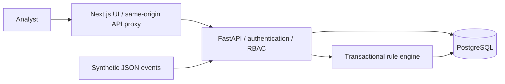
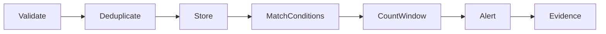
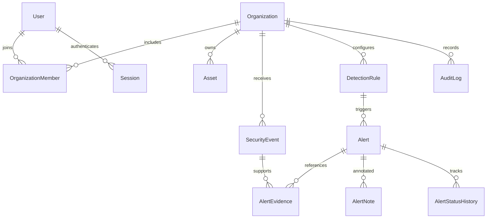
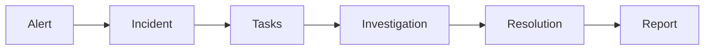
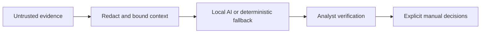

# Architecture

All resource reads and writes include the authenticated membership's organization ID. Clients cannot select a tenant through request bodies. Foreign references are checked within the same organization. UUIDs are identifiers, never authorization controls. Events are immutable; deleting assets detaches historical alert references. Accounts own one workspace in Phase 1; switching organizations and invitations are deferred.

Planned Phase 2 workflow (not implemented in Phase 1):

Planned Phase 3 AI boundary (not implemented in Phase 1):

